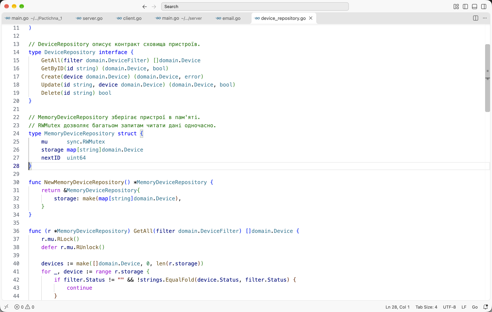
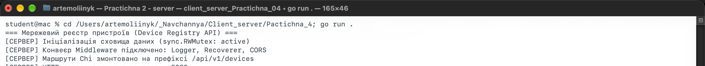
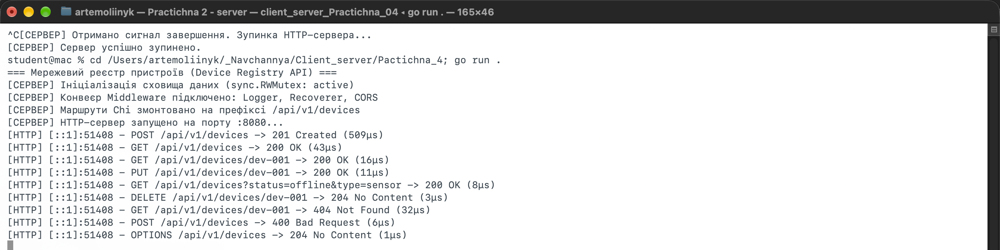
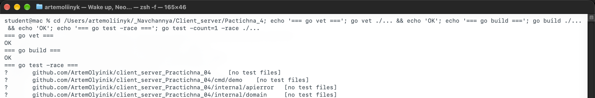

# Практична робота № 4. Побудова REST API з використанням маршрутизатора Chi

**Виконав:** Олійник Артем Сергійович  
**Курс:** IV  
**Група:** КН-43  
**Дисципліна:** Розробка застосувань клієнт-серверної архітектури  
**Викладач:** Олександр Олександрович Верещагін  
**Рік:** 2026

---

## Мета роботи

- Опанувати проєктування REST API з коректною семантикою HTTP-методів.
- Налаштувати маршрутизатор `go-chi/chi/v5`, суб-роутери та параметри шляху.
- Розділити код на шари `domain`, `repository`, `handler`.
- Захистити in-memory сховище через `sync.RWMutex`.
- Підключити Middleware логування, відновлення після паніки та CORS.

---

## Середовище

| Компонент | Версія |
|---|---|
| Операційна система | macOS 27.0.1 |
| Go | 1.27.1 |
| Chi | `github.com/go-chi/chi/v5` 5.5.0 |
| Visual Studio Code | 1.145.2 |

Модуль проєкту: `github.com/ArtemOlyinik/client_server_Practichna_04`.

---

## Структура проєкту

```text
client_server_Practichna_04/
├── cmd/demo/main.go                 # HTTP-клієнт для перевірки API
├── docs/                            # текст завдання
├── internal/apierror/               # єдиний формат помилок
├── internal/domain/                 # модель Device
├── internal/handler/                # HTTP-обробники
├── internal/middleware/             # Logger, Recoverer, CORS
├── internal/repository/             # in-memory сховище з RWMutex
├── screenshots/                     # скріншоти роботи
├── main.go                          # точка входу та маршрути Chi
├── requests.http                    # приклади запитів
└── README.md
```

---

## Хід виконання

### Рівень 1. Структура проєкту, сховище RWMutex та читання/створення ресурсів

#### 1. Ініціалізація та залежності

Створюємо модуль і встановлюємо Chi:

```bash
go mod init github.com/ArtemOlyinik/client_server_Practichna_04
go get github.com/go-chi/chi/v5
```

Код розділено на пакети `internal/domain`, `internal/repository`, `internal/handler`. Такий поділ відокремлює модель, збереження та HTTP-шар.

#### 2. Модель Device

```go
type Device struct {
    ID        string    `json:"id"`
    Name      string    `json:"name"`
    IPAddress string    `json:"ip_address"`
    Type      string    `json:"type"`
    Status    string    `json:"status"`
    UpdatedAt time.Time `json:"updated_at"`
}
```

Поля відповідають JSON-ключам `id`, `name`, `ip_address`, `type`, `status`, `updated_at`.

#### 3. Потокобезпечний репозиторій

Інтерфейс `DeviceRepository` описує операції `GetAll`, `GetByID`, `Create`, `Update`, `Delete`. Реалізація `MemoryDeviceRepository` зберігає пристрої в мапі та використовує `sync.RWMutex`:

```go
type MemoryDeviceRepository struct {
    mu      sync.RWMutex
    storage map[string]domain.Device
    nextID  uint64
}
```

`GetAll` і `GetByID` беруть `RLock`, а `Create`, `Update`, `Delete` - `Lock`. Це дозволяє багатьом запитам читати дані одночасно й блокує доступ лише на час зміни.



*Рис. 1. Інтерфейс `DeviceRepository` і структура `MemoryDeviceRepository` із `sync.RWMutex`.*

Під час створення репозиторій генерує послідовний ID `dev-001`, `dev-002` і встановлює `UpdatedAt` у UTC.

#### 4. Маршрути Chi та початкові обробники

```go
router.Route("/api/v1/devices", func(r chi.Router) {
    r.Get("/", deviceHandler.List)
    r.Post("/", deviceHandler.Create)

    r.Route("/{id}", func(r chi.Router) {
        r.Get("/", deviceHandler.Get)
        r.Put("/", deviceHandler.Update)
        r.Delete("/", deviceHandler.Delete)
    })
})
```

Обробник `Create` читає JSON, перевіряє обов'язкові поля `name`, `ip_address`, `type` і допустимі значення `status`. За успіху повертає `201 Created` та заголовок `Location`. `Get` витягує `id` через `chi.URLParam` і повертає `404`, якщо пристрій не знайдено.

#### 5. Перевірка роботи

Запускаємо сервер:

```bash
go run .
```



*Рис. 2. Старт сервера: сховище, конвеєр Middleware, маршрути Chi і порт 8080.*

Для перевірки використовуємо окремий HTTP-клієнт `cmd/demo`, який виконує повний життєвий цикл ресурсу:

```bash
go run ./cmd/demo
```


*Рис. 3. `POST` повернув `201 Created` з ID `dev-001`, `GET` списку та `GET` за ID повернули `200 OK`, `PUT` повернув оновлений об'єкт.*

---

### Рівень 2. Повний REST CRUD та Middleware логування

#### 1. Оновлення та видалення

Додано методи `Update` і `Delete`. `Update` змінює поля, встановлює новий `UpdatedAt` і повертає оновлений об'єкт. `Delete` видаляє ключ із мапи та повертає `204 No Content` без тіла відповіді.

#### 2. Життєвий цикл ресурсу

Демонстраційний клієнт проходить ланцюжок:

1. `POST /api/v1/devices` - створення;
2. `GET /api/v1/devices` - читання списку;
3. `GET /api/v1/devices/dev-001` - читання одного ресурсу;
4. `PUT /api/v1/devices/dev-001` - оновлення;
5. `DELETE /api/v1/devices/dev-001` - видалення;
6. `GET /api/v1/devices/dev-001` - перевірка `404`.


*Рис. 4. Оновлення, фільтрація, видалення, повторне читання з `404`, помилка валідації `400` і CORS preflight `204`.*

#### 3. Middleware логування

Підключено `middleware.RequestID`, `middleware.RealIP` і власний `Logger`. Лог містить метод, шлях, статус, тривалість і віддалену адресу:

```text
[HTTP] [::1]:51408 - POST /api/v1/devices -> 201 Created (509µs)
[HTTP] [::1]:51408 - GET /api/v1/devices -> 200 OK (43µs)
[HTTP] [::1]:51408 - PUT /api/v1/devices/dev-001 -> 200 OK (11µs)
```



*Рис. 5. Консоль сервера: усі запити життєвого циклу з кодами `201`, `200`, `204`, `404`, `400` та `OPTIONS`.*

---

### Рівень 3. Фільтрація, стандартизація помилок та захисні Middleware

#### 1. Фільтрація за query-параметрами

`GET /api/v1/devices` читає `status` і `type`:

```go
filter := domain.DeviceFilter{
    Status: r.URL.Query().Get("status"),
    Type:   r.URL.Query().Get("type"),
}
```

Репозиторій повертає лише ті пристрої, які відповідають усім заданим умовам. Якщо параметрів немає, повертається повний список. У демонстрації запит `?status=offline&type=sensor` повернув один оновлений пристрій.

#### 2. Єдиний формат помилок

Усі помилки повертаються у структурі `apierror.Error`:

```json
{
  "error": "Resource Not Found",
  "message": "Device with ID 'dev-001' does not exist in registry",
  "status": 404,
  "timestamp": "2026-11-09T09:57:46.133046Z"
}
```

Такий самий формат використовується для некоректного JSON, відсутніх полів і помилки `500`. Заголовок `Content-Type` встановлюється як `application/json; charset=utf-8`.

#### 3. Panic Recovery

Middleware `Recoverer` використовує `defer` і `recover()`, логує стек викликів та повертає клієнту стандартизований `500 Internal Server Error`. Це не дає одній паніці зупинити весь сервер.

#### 4. CORS

Middleware `CORS` встановлює:

- `Access-Control-Allow-Origin: *`;
- `Access-Control-Allow-Methods: GET, POST, PUT, DELETE, OPTIONS`;
- `Access-Control-Allow-Headers: Content-Type, Authorization`.

Запит `OPTIONS` повертає `204 No Content` без тіла. У демонстрації ці заголовки видно в консолі клієнта (рис. 4).

#### 5. Тести та збірка

```bash
go vet ./...
go build ./...
go test -count=1 -race ./...
```



*Рис. 6. `go vet` і `go build` без помилок, тести `handler` і `repository` пройшли з детектором гонок.*

---

## Таблиця ендпоінтів

| Метод | Шлях | Призначення | Успіх |
|---|---|---|---|
| `GET` | `/api/v1/devices` | список пристроїв, фільтри `status`, `type` | `200 OK` |
| `POST` | `/api/v1/devices` | створення пристрою | `201 Created` |
| `GET` | `/api/v1/devices/{id}` | один пристрій | `200 OK` / `404` |
| `PUT` | `/api/v1/devices/{id}` | повне оновлення | `200 OK` / `404` |
| `DELETE` | `/api/v1/devices/{id}` | видалення | `204 No Content` / `404` |
| `OPTIONS` | `/api/v1/devices` | CORS preflight | `204 No Content` |

---

## Інструкція запуску

```bash
# 1. Перейти в директорію проєкту
cd client_server_Practichna_04

# 2. Завантажити залежності
go mod download

# 3. Запустити сервер
go run .

# 4. В іншому терміналі виконати демонстраційний клієнт
go run ./cmd/demo

# 5. Перевірити тести
go test -race ./...
```

Приклади запитів також зібрано у файлі `requests.http` для REST Client у Visual Studio Code.

---

## Висновки

У роботі побудовано REST API реєстру пристроїв на маршрутизаторі Chi. Код розділено на доменну модель, потокобезпечний репозиторій та HTTP-обробники. Репозиторій використовує `sync.RWMutex`, тому одночасні читання не блокують одне одного, а зміни виконуються ексклюзивно.

Реалізовано повний CRUD, фільтрацію за `status` і `type`, єдиний формат помилок, логування запитів, відновлення після паніки та CORS. Демонстраційний клієнт пройшов життєвий цикл `Create → Read → Update → Delete → Read` і отримав очікувані коди `201`, `200`, `204`, `404`, `400` та `204` для preflight. Тести з детектором гонок проходять без помилок.

---

## Контрольні питання

1. **Чим REST відрізняється від RPC?**  
   REST працює з ресурсами за URI та використовує стандартні HTTP-методи й коди стану. RPC викликає віддалені процедури за іменами методів. REST легше кешувати та масштабувати, RPC буває зручнішим для складних дій.

2. **Які методи безпечні та ідемпотентні?**  
   `GET` безпечний та ідемпотентний, `POST` неідемпотентний, `PUT` ідемпотентний, `DELETE` ідемпотентний. Безпечний метод не змінює стан, ідемпотентний дає однаковий результат при повторному виклику.

3. **Які переваги Chi над `http.ServeMux`?**  
   Chi має дерево Radix Tree, параметри шляху, суб-роутери, Middleware, групи маршрутів і зручні хелпери. Це спрощує побудову великих API та дозволяє вкладати маршрути.

4. **Навіщо `sync.RWMutex`, а не звичайний `sync.Mutex`?**  
   `RWMutex` дозволяє багатьом читачам працювати одночасно, блокуючи лише записи. Для реєстру пристроїв читань зазвичай більше, ніж змін, тому це підвищує пропускну здатність.

5. **Коли повертають `204 No Content`?**  
   Коли операція успішна, але тіла відповіді немає, наприклад після `DELETE`. Передавати дані в тілі `204` заборонено стандартом.

6. **Як працює ланцюжок Middleware?**  
   Кожен Middleware приймає `http.Handler` і повертає новий handler, який виконує свою логіку до або після `next.ServeHTTP`. Так запит проходить через логування, recovery, CORS та основний обробник.

7. **Як `recover()` захищає сервер?**  
   У `defer` middleware викликається `recover()`, який перехоплює паніку в обробнику. Замість аварійного завершення процесу клієнт отримує `500`, а стек записується в лог.

8. **Що таке CORS і навіщо він потрібен?**  
   CORS - це політика браузера, яка дозволяє або блокує міждоменні запити. Сервер має повернути заголовки `Access-Control-Allow-*`, інакше браузер не дасть сторінці прочитати відповідь API з іншого домену.
